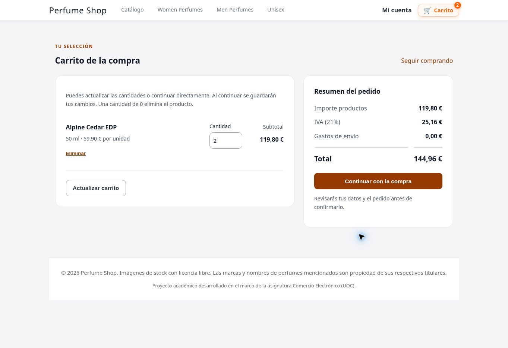

# Comercio electrónico · Tienda de perfumes

Proyecto académico de Comercio Electrónico de la UOC, desarrollado en PHP y MySQL/MariaDB. Se está actualizando mediante mejoras incrementales y comprobadas para evolucionar hacia una tienda completa.

**Estado: prototipo en desarrollo.** Todavía no está preparado para operar con clientes ni cobrar pagos reales.

[Ver el código de la tienda](https://github.com/Rpfdeveloper/comercio-electronico/tree/main/tienda) · [Registro de progreso](https://github.com/Rpfdeveloper/comercio-electronico/blob/develop/docs/PROGRESO.md) · [Hoja de ruta](https://github.com/Rpfdeveloper/comercio-electronico/blob/develop/docs/HOJA_DE_RUTA.md)

## Último avance: carrito y compra clara

- Las cantidades se guardan y validan al pulsar «Continuar con la compra».
- Desglose de productos, IVA, envío y total coherente desde el carrito hasta el pedido.
- Formulario con autocompletado, errores por campo y enlaces para corregirlos, sin perder los datos válidos.
- Compra como invitado o con cuenta, con controles de contraseña y validación de longitudes Unicode.
- Diseño revisado en escritorio y marcos de 320, 390 y 768 px, conservando las protecciones de stock y cuentas.

Validación: **286 comprobaciones por entorno**, incluidas 47 nuevas de checkout. [GitHub Actions](https://github.com/Rpfdeveloper/comercio-electronico/actions/runs/41151317474) pasa con PHP 8.3 y 8.4 y MariaDB 11.4; 39 archivos PHP sin errores de sintaxis y logs sin avisos. [Ver cambios en el PR #2](https://github.com/Rpfdeveloper/comercio-electronico/pull/2).

[Carrito y checkout](docs/COMPRA.md) · [Catálogo y filtros](docs/CATALOGO.md) · [Administración](docs/ADMINISTRACION.md) · [Cuentas de clientes](docs/CUENTAS_CLIENTE.md) · [Ejecutar las pruebas](tests/README.md)

## Funcionalidad y siguientes pasos

La tienda incluye catálogo, categorías, fichas, carrito, compra invitada o registrada y administración de pedidos. Las mejoras anteriores incorporaron CSRF, validación de cantidades y variantes, relectura de precios, descuento transaccional de stock y pruebas de compras simultáneas.

Pendientes principales: verificación de correo, recuperación de contraseña, MFA administrativo, carrito persistente, reservas y pagos en modo de pruebas, envío real de correos y revisión de producción.

La primera integración en `main` se realizó mediante el [PR #1](https://github.com/Rpfdeveloper/comercio-electronico/pull/1), después de verificar las copias de seguridad y corregir la observación de revisión.

## Ramas y recuperación

- `develop`: preparación y comprobación de las siguientes mejoras.
- `main`: tienda, pruebas y documentación de las entregas integradas mediante pull request.
- `original`: entrega académica recuperada, conservada como referencia.
- `backup/2026-10-31-*`: copias verificadas antes de cada integración. La mejora de checkout conserva el estado anterior en `backup/2026-10-31-antes-checkout-e19ae30`.

La recuperación del 30 de octubre de 2026 verificó 43 archivos: 40 idénticos a la entrega y tres ajustados para retirar contraseñas incrustadas. Las 24 imágenes se conservaron sin compresión ni cambios. [Historial de recuperación](https://github.com/Rpfdeveloper/comercio-electronico/commits/original/).

## Configuración privada

Definir `TIENDA_DB_PASS`, `TIENDA_ADMIN_PASS` y `TIENDA_AUTH_SECRET` en el entorno del servidor. La aplicación no carga `.env` automáticamente. Mantener `TIENDA_DEBUG=false` fuera de las pruebas. No publicar credenciales, sesiones, logs ni copias de datos.

Para una instalación nueva, adaptar la contraseña de ejemplo del esquema SQL en una copia privada. Para actualizar una base existente, aplicar las migraciones indicadas en la guía de cuentas, sin volver a importar el esquema que recrea tablas. HTTPS y la configuración final del servidor deben revisarse antes de un despliegue público.
