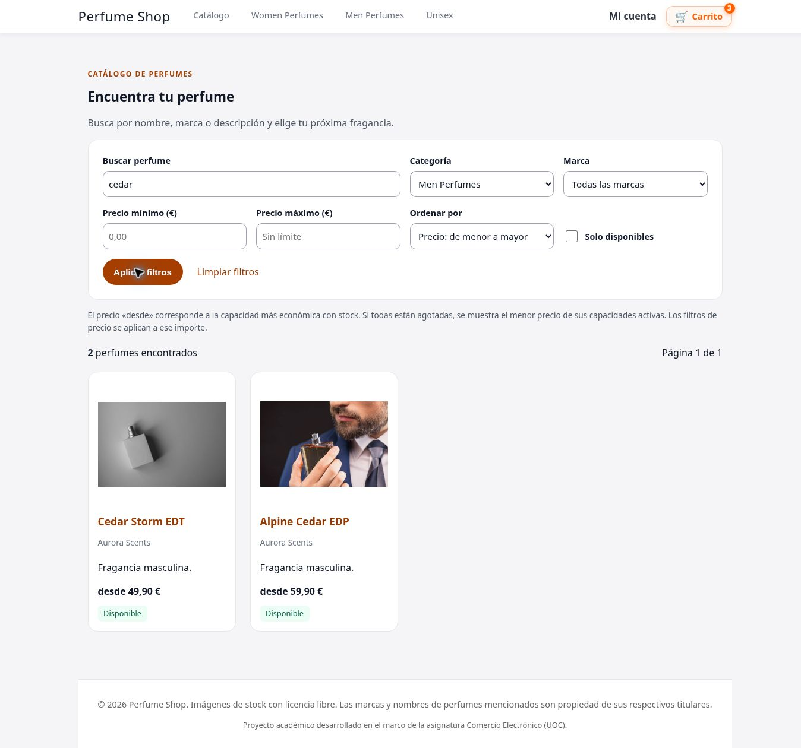
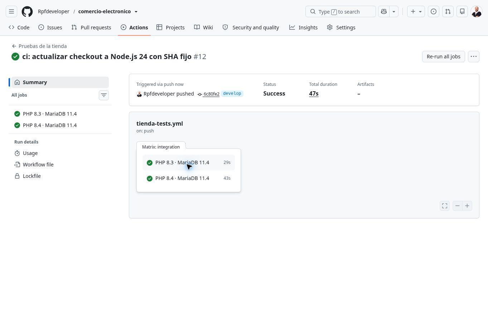
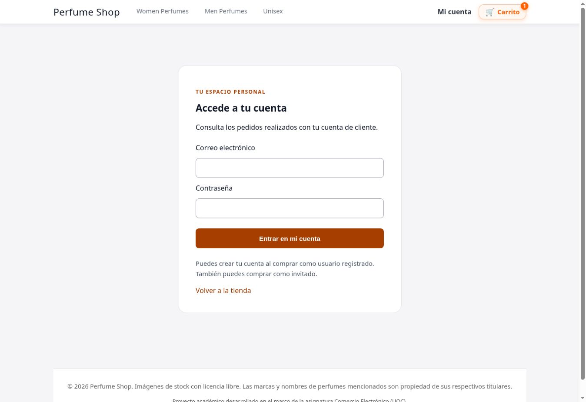

# Progreso de la tienda

Registro técnico de cambios verificables en `develop`. La rama `original` conserva la entrega recuperada. El proyecto sigue siendo un prototipo: no procesa pagos ni envía correos reales.

## Revisión del PR #1 — categorías inactivas (31 de octubre de 2026)

La revisión detectó que retirar una categoría ocultaba sus fichas, pero un carrito anterior o un POST directo todavía podían comprar sus productos. Se corrige en la validación compartida del carrito y del checkout: categoría activa obligatoria, lectura actual y bloqueo compartido durante la transacción de confirmación.

Las pruebas cubren productos con y sin variantes, altas directas, actualización de cantidades, entrada al checkout, resúmenes anteriores, conservación de stock y eliminación de la línea. Se comprueba además la retirada de una categoría cuando dos confirmaciones ya han pasado la primera validación y esperan el producto: ambas devuelven 409, sin pedidos ni descuentos. Las compras simultáneas normales siguen pasando.

**239 comprobaciones correctas por entorno**: 41 de compra, 45 de cuenta, 48 administrativas, 73 de catálogo y 32 de concurrencia. [Validación de GitHub Actions](https://github.com/Rpfdeveloper/comercio-electronico/actions/runs/41145205094), sobre `96ac17e4d6465ca53a90e4c841bfd39fae3d9067`, con PHP 8.3 y 8.4 y MariaDB 11.4. Los 35 PHP pasan sintaxis y los logs no presentan avisos PHP. Las modificaciones posteriores son de documentación.

Antes de abrir el [PR #1](https://github.com/Rpfdeveloper/comercio-electronico/pull/1), se verificaron copias del código y su historial en `backup/2026-10-31-main-85fbc66` y `backup/2026-10-31-develop-e300be6`. Son ramas del mismo repositorio; no incluyen una base de datos de producción. `original` se conserva sin cambios.

## Catálogo — búsqueda, filtros y paginación

- Nueva página `catalogo.php` con búsqueda por nombre, marca y descripción corta; filtros combinables por categoría, marca, precio y disponibilidad.
- Orden por nombre, precio ascendente/descendente o incorporación reciente, con desempate estable y doce resultados por página. Las URL conservan los filtros; aplicar filtros reinicia la paginación.
- Se mantienen las URL de categorías. Parámetros no escalares o inválidos reciben 422; recursos o páginas inexistentes, 404 antes de emitir HTML. Las búsquedas sin resultados reciben 200 con una explicación.
- Precios efectivos coherentes con el carrito: una capacidad agotada no determina el precio «desde» mientras haya otras comprables. Las variantes inactivas no permiten reutilizar stock o precio base.
- Fichas de productos/categorías inactivos ocultas, capacidades agotadas deshabilitadas y primera capacidad disponible seleccionada por precio. Botón de compra deshabilitado cuando no hay stock.
- Navegación al catálogo, controles etiquetados, foco visible y estilos adaptables. Revisión visual en escritorio: búsqueda, precio máximo, categoría, orden y segunda página.
- CI ampliada a ramas `mejora/**` para comprobar las entregas antes de incorporarlas a `develop`. La conexión de las fixtures utiliza UTF-8 explícito; la nueva suite detectó y permitió corregir la normalización incorrecta de `page=0`.

Validación local: **222 comprobaciones** (41 + 45 + 48 + 59 + 29), 35 PHP sin errores de sintaxis y logs sin avisos, con PHP 8.3.6 y MariaDB 10.11.14. [GitHub Actions](https://github.com/Rpfdeveloper/comercio-electronico/actions/runs/41141911642), sobre `1dfc6bdad1bbe4c2dbc91800a54139e65fd1869e`: **222 comprobaciones correctas en cada versión**, PHP 8.3 y 8.4 con MariaDB 11.4; 444 ejecuciones, 222 casos distintos. Sintaxis, revisión de patrones sensibles y logs correctos en ambos entornos. Las publicaciones posteriores a ese commit solo añaden documentación y evidencia visual.

[Comportamiento, instalación y límites](CATALOGO.md). No requiere cambios en la base de datos. La búsqueda es por fragmentos y los filtros de precio se aplican al importe «desde»; faltan pruebas de rendimiento con catálogos grandes, móvil real y revisión completa de accesibilidad.

## Panel de administración — nueva iteración

- Sesión propia `TIENDAADMIN`, con cookie limitada al directorio administrativo. Cerrar la administración conserva la cuenta y el carrito del cliente, y cerrar la cuenta no cierra el panel.
- Renovación de identificador y CSRF; caducidad tras 15 minutos de inactividad o cuatro horas totales. La huella de configuración invalida sesiones cuando cambia la contraseña o el secreto.
- Límites persistidos por cuenta e IP, separados de los de clientes. Cambiar el usuario enviado no reinicia el contador; una autenticación correcta conserva el contador por IP.
- Páginas sin caché, mensajes genéricos y 404 para pedidos inexistentes o identificadores malformados.
- Actualización de `actions/checkout` a [v7.0.1](https://github.com/actions/checkout/releases/tag/v7.0.1), fijada a su commit y con Node.js 24, conservando permisos de solo lectura y `persist-credentials: false`.
- Limitador común extraído a `auth.php`, conservando las claves de contadores y el comportamiento de los clientes. Se reutiliza la migración 002.
- La prueba de dos intentos detectó un 503 transitorio: se incorpora bloqueo exclusivo desde la lectura/alta del contador y reintento acotado de la transacción completa, conservando el límite y su rechazo 429.

Validación local con PHP 8.3.6 y MariaDB 10.11.14: **163 comprobaciones correctas** (41 de compra, 45 de cuenta, 48 administrativas y 29 de concurrencia), 31 PHP sin errores de sintaxis y log sin avisos. [Ejecución en GitHub Actions](https://github.com/Rpfdeveloper/comercio-electronico/actions/runs/41137901221), sobre `6c80fe2a20361b5f92f0dd9cc5bd602536823b5d`: **163 comprobaciones correctas en cada versión**, PHP 8.3 y 8.4 con MariaDB 11.4 (326 ejecuciones, no 326 casos distintos), sintaxis correcta y logs sin avisos PHP.

[Configuración, límites y actualización del panel](ADMINISTRACION.md). Al desplegar esta mejora los administradores deben volver a iniciar sesión; no se admiten las sesiones antiguas. La administración sigue usando una única cuenta, sin MFA ni roles múltiples. La separación de cookies no sustituye las defensas contra XSS en el mismo origen.

## Cuenta de cliente e historial privado

Implementado:
- Acceso y cierre de sesión independientes, con formularios protegidos por CSRF.
- Historial paginado de 20 pedidos y detalle restringido al identificador del cliente autenticado. Las compras invitadas no se vinculan por coincidencia de correo.
- Datos de la cuenta disponibles en el checkout sin repetir la contraseña durante una sesión válida.
- Renovación de sesión al entrar y salir; caducidad tras 30 minutos de inactividad u ocho horas totales. Un cambio del hash de contraseña invalida la sesión.
- Páginas de cuenta con `Cache-Control: no-store` y contenido escapado.
- Límites compartidos entre acceso y checkout: cinco intentos por correo y 30 por IP en ventanas de 15 minutos. Los identificadores se guardan como HMAC con un secreto externo, sin correo ni IP en claro en esos contadores.
- Contraseñas nuevas de al menos 15 caracteres y un máximo de 72 bytes; las cuentas existentes conservan sus credenciales.
- Migración aditiva `002_customer_access.sql` y revisión automática de archivos/patrones sensibles antes de las pruebas.

Validación local: PHP 8.3.6 y MariaDB 10.11.14; **41 pruebas de compra + 45 de cuenta/privacidad + 29 de concurrencia = 115 comprobaciones**. Los 27 archivos PHP pasan la comprobación de sintaxis y el log del servidor no presenta avisos, errores ni deprecaciones en esa ejecución. Los datos utilizados son ficticios.

**GitHub Actions verificado:** [ejecución 41134720548](https://github.com/Rpfdeveloper/comercio-electronico/actions/runs/41134720548), sobre `816b101fe2f6d37ce9d1c3a49195fa1c858d1cc2`. PHP 8.3 y 8.4 con MariaDB 11.4: 115 comprobaciones correctas en cada entorno (230 ejecuciones, no 230 casos distintos), sintaxis correcta, revisión de patrones sensibles correcta y logs sin avisos PHP. Se incluye el rechazo de alias Unicode que la colación SQL podría confundir con otro correo. La lectura posterior de GitHub confirmó el contenido publicado y correo `noreply` en los nuevos commits.

Se ha revisado visualmente la pantalla de acceso en escritorio. La revisión completa de móvil, teclado y lectores de pantalla sigue pendiente.

[Historial de cambios](https://github.com/Rpfdeveloper/comercio-electronico/commits/develop/) · [Resultados de CI](https://github.com/Rpfdeveloper/comercio-electronico/actions) · [Instalación de esta mejora](CUENTAS_CLIENTE.md) · [Hoja de ruta](HOJA_DE_RUTA.md)

## Siguiente trabajo

- Verificación del correo y recuperación de contraseña con tokens de un solo uso y caducidad.
- MFA y roles administrativos, con revisión de despliegue y acceso restringido.
- Carrito persistente y revisión completa del checkout en móvil y con teclado.
- Reservas y estados de pago antes de conectar una pasarela en modo de pruebas.

## Criterio para registrar avances

Cada entrega debe indicar comportamiento, comprobaciones realizadas y limitaciones. Publicar solo código, documentación técnica y datos ficticios; excluir conversaciones, correos personales, credenciales, sesiones, logs y exportaciones de clientes. Utilizar correo `noreply` en nuevos commits y comprobar los metadatos de autoría tras publicar. La revisión automática ayuda a detectar patrones comunes, pero no sustituye la revisión del diff ni analiza exhaustivamente archivos binarios o el historial anterior.
